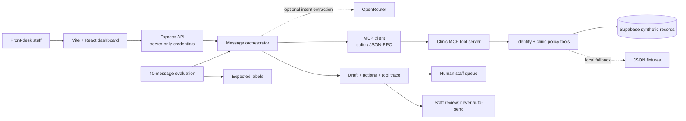

# Edvak Forge demo and interview guide

This guide maps the take-home brief to the running prototype and gives you a repeatable way to demo it. The clinic, staff, patients, messages, appointments, and medication records in this project are fictional.

> **Resolve before the interview:** the narrative in `README.md` currently reports a 97.5% action exact match with an M020 mismatch, while the checked-in `reports/evaluation.json` shows a 100% action exact match and all 40 cases passing. Run the rules evaluation on the code you plan to demo, then make the README and report agree before quoting a score.

## 1. Before the demo

- [ ] Open a terminal in the project folder.
- [ ] Install dependencies once with `npm install`.
- [ ] Confirm `.env` has the connection values you intend to demo. Keep `.env` private; never paste or commit its keys.
- [ ] Start the app with `npm run dev` and open `http://127.0.0.1:5173`.
- [ ] Open **Settings**. Check whether the active data source is Supabase or local fixtures, whether the clinic MCP server is connected, and how many tools it exposes.
- [ ] If using Supabase, check that the synthetic fixture tables have been seeded. If Supabase is not configured, the app can use local fixture data instead.
- [ ] If you want model-assisted intent extraction, verify one message request actually succeeds through OpenRouter. A configured key can still be rejected by the provider or have no available credit; the app then records and displays its local-rules fallback mode.
- [ ] Use synthetic messages only. Do not enter real patient information.
- [ ] Keep the Evaluation Lab ready. A rules evaluation is free; the model evaluation processes 40 messages and may incur provider charges.

## 2. A clear 7-minute walkthrough

### 0:00-0:45 — Set the context

Explain the problem: Maplewood Family Clinic receives messages about refills, appointments, billing, records, and occasional emergencies. The prototype classifies a message, checks applicable clinic data and rules, drafts a response, and routes work for staff review.

Be explicit that this is a synthetic take-home prototype. It has no live SMS/email delivery, production staff authentication, or production authorization model.

### 0:45-1:30 — Show the architecture

The browser calls the Express API. The API orchestrates the analysis, optionally asks OpenRouter to extract intent, and invokes clinic tools through the MCP client over stdio. The clinic MCP server applies the identity, refill, scheduling, routing, and draft rules. Supabase can hold the synthetic records and saved agent runs; local JSON fixtures are the fallback. The output is an editable draft plus a human queue item. No patient reply is sent.



### 1:30-3:00 — Demonstrate an emergency

- [ ] In **Inbox**, choose the synthetic chest-pain / shortness-of-breath example or select an existing emergency fixture.
- [ ] Click **Process with AI** for a fixture message, or use **Test a message** to enter new synthetic text.
- [ ] Show the urgency, suggested emergency escalation, clinician queue, and safety-directed draft.
- [ ] Open **Tool Calls** and **Timeline** to show what ran and where human review remains.
- [ ] Point out that an emergency draft tells the sender to contact emergency services / go to the nearest emergency department and says the clinic has been alerted. The prototype does not answer automatically or contact emergency services.

### 3:00-4:15 — Let the interviewer test a new message

1. Click **Test a message** in the Inbox header. It scrolls to and opens the form.
2. Choose **Emergency** or **Appointment** to load a fictional example, or write a new synthetic message they choose.
3. Keep the fictional default sender/contact for an unverified-sender scenario. For an identity-gated workflow, use a matching fictional sender and contact shown in the Patients screen; do not use real information.
4. Choose Portal, SMS, or Email and click **Analyze test message**.
5. The new result opens in the inbox. Show **AI Analysis**, **Patient Context**, **Tool Calls**, and **Timeline**.
6. Show the editable draft and the **NOT SENT · REVIEW REQUIRED** status. The action runs analysis and saves an agent run; it does not send a message or insert the custom text into the 40-message benchmark fixture.

If OpenRouter is unavailable, explain that the result uses the labeled local-rules mode. Do not describe that run as model-generated.

### 4:15-5:15 — Show one clinic workflow

- [ ] Show a refill request and the MCP eligibility result. Eligible refills still enter the provider review queue; this system never approves a prescription.
- [ ] Or show appointment slot search and booking/reschedule/cancel from **Appointments**. Explain that the tools check clinic hours, holidays, provider leave, and conflicts. Use only the synthetic schedule.

### 5:15-6:15 — Show measured reliability

- [ ] Open **Evaluation Lab** and explain the 40 labeled synthetic cases.
- [ ] Show urgency accuracy, emergency recall, action exact match/F1, patient matching, and must-not violations.
- [ ] Run the rules baseline before the interview and quote its fresh report, not a remembered score.
- [ ] If you run the model evaluation, note the model name, prompt/completion token totals, and provider-reported total cost from the Evaluation Lab. If the provider omits cost, calculate it from the model's current token rates and label it an estimate. Include the date because rates can change.
- [ ] Explain any remaining mismatches and must-not violations. The current README and checked-in report disagree about M020, so reconcile them before the demo.
- [ ] Be candid: the dataset is small and synthetic; even perfect scores do not establish safety or generalization.
- [ ] If asked to run OpenRouter evaluation live, explain that it makes 40 provider calls and can cost money. Confirm a single model request works before choosing that mode.

### 6:15-7:00 — Close with trade-offs

Summarize what is deliberately absent: live messaging, production authentication/authorization, real patient data, and automatic clinical decisions. Discuss what needs to change before real-world use in the interview answers below.

## 3. Take-home brief coverage checklist

| Take-home requirement | What to show or explain |
| --- | --- |
| MCP server over clinic data | Settings connection status and registered tools; open **Tool Calls** on an analyzed message. `npm run mcp` runs the standalone stdio tool server. |
| Find and verify a patient | Show identity status and the protected **Patient Context** tab. Explain that a name alone is not treated as verification. |
| Medication and refill policy | Show medication lookup, eligibility, and provider approval queue. |
| Find/book/reschedule/cancel appointments | Show the Appointments page and explain identity and conflict checks. |
| Route to the requested human queues | Show a queue item in the message detail or **Audit & Safety**. Queues include urgent/routine clinician, provider refills, front desk, and billing. |
| Draft a response | Show the editable reply, saved draft, review status, and no-send indicator. |
| Process all 40 sample messages | Open **Evaluation Lab** or run `npm run evaluate`. |
| Evaluate expected outcomes | Show urgency accuracy, emergency recall, action accuracy/F1, patient match, missed emergencies, and must-not violations. |
| Keep data synthetic | Reiterate the fictional dataset and never enter real patient data. |
| Provide runnable code and README | Show the repository README's setup commands, architecture, results, limitations, reuse/build notes, and next steps. |
| Be ready for unseen messages | Use **Test a message** during the conversation and inspect its analysis, MCP trace, draft, and route. |

## 4. Likely interview questions and answer points

### “Walk me through what happens after a message arrives.”

The UI sends it to Express; the orchestrator uses optional model extraction and deterministic policy checks; the MCP client calls the clinic tools; the result includes classification, identity/verification status, actions, route, draft, and trace; the app saves a staff-review run. A human decides what happens next.

### “Why MCP? What did you build yourself?”

MCP gives the agent a narrow, inspectable interface to clinic operations instead of broad database access. Explain that this prototype implements the clinic tool server and orchestration, fixture/policy integration, UI, and evaluation flow; name any libraries/frameworks reused rather than implying they were authored from scratch.

### “Why use an LLM if you have rules?”

The model can help interpret varied language and extract intent/preferences. Deterministic code owns safety-critical decisions such as identity gates, emergency instructions, refill eligibility, and scheduling conflicts. The model does not get a send-message or prescription-approval capability.

### “What are the actual results, and where does it fail?”

Give the measured rules baseline from the fresh Evaluation Lab/CLI run. The README and checked-in report currently disagree about the M020 action result, so reconcile them before presenting a final score. Describe remaining mismatches instead of hiding them, and emphasize that a small synthetic benchmark is not evidence of clinical safety.

### “What happens if the model or a tool fails?”

Show the recorded mode and connection health. OpenRouter can fall back to local rules; do not claim the fallback is equivalent to the model. Explain how you would test/handle MCP timeouts and partial failures before production.

### “What would you do with another week?”

Prioritize broader adversarial evaluation and failure analysis, robust tool timeouts/retries and observability, stronger role-based authorization and audit controls, usability sessions with front-desk staff, and a carefully governed integration plan for any live communication channel.

### “How did you choose the scope?”

The brief asks for roughly 6-8 focused hours. Explain which requirements you made end-to-end, what you reused (frameworks, SDKs, and the supplied fictional data/labels), what you built for this prototype, and what you intentionally left out. Connect those cuts to the demo evidence and safety boundaries.

### “What must change before real patient data?”

Production identity and access controls, least-privilege service credentials, tenant isolation, verified retention/deletion behavior, encryption and audit review, security/privacy assessment, clinical safety review, provider/vendor approvals, monitoring and incident response, and a validated deployment/evaluation process. This prototype is not approved for PHI or clinical deployment.

### “How much does the model run cost?”

Do not guess. Confirm the chosen OpenRouter model and provider pricing on demo day, then report the actual usage/cost shown by the run. The rules baseline makes no model calls. A model evaluation makes 40 calls and may incur charges.

## 5. Useful commands

```powershell
npm run dev
npm run evaluate
npm run build
npm start
npm run mcp
```

`npm run dev` starts the local API and Vite dashboard. `npm run evaluate` evaluates the 40-message rules baseline. `npm run build` type-checks and builds the app. `npm start` serves the built app on the configured API port (4317 by default). `npm run mcp` starts the standalone MCP stdio server for MCP clients.

## 6. Demo-day honesty checklist

- [ ] Say whether the current result used OpenRouter or local rules.
- [ ] Say whether the data source is Supabase or local fixtures.
- [ ] Show MCP connection/tool count instead of just claiming the agent uses tools.
- [ ] Report the M020 action mismatch and the synthetic sample size.
- [ ] Do not claim a message, prescription, or emergency escalation was sent to an external system.
- [ ] Do not enter real patient information or use this prototype for clinical care.
