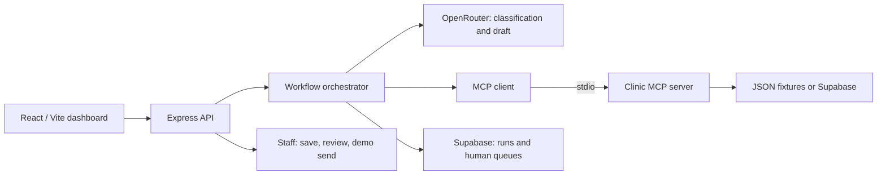

# Edvak Forge — AI Front Desk

A prototype for triaging the provided fictional clinic messages, checking clinic policies, managing appointments, and preparing replies for staff review. **Use synthetic data only.** Refills require provider approval. “Send (demo)” records an audit status; it does not deliver SMS or email.

## Run and demo

Requires Node.js 22.12+ and npm.

```powershell
npm install
Copy-Item .env.example .env
npm run dev
```

`npm run dev` starts both the backend and frontend in one terminal. The dashboard starts after the API health check succeeds; Ctrl+C stops both. Open http://127.0.0.1:5173. Empty credentials select JSON fixtures and local rules. For model analysis, set `OPENROUTER_API_KEY`; `OPENROUTER_MODEL` defaults to `openai/gpt-4o-mini`. Keys stay on the server.

Optional Supabase: set `SUPABASE_URL` and `SUPABASE_SECRET_KEY`, apply `supabase/migrations`, and run `npm run seed:supabase`. Draft/review/demo-send persistence requires Supabase. JSON mode supports the assignment's data option; local appointment changes persist in `.runtime/appointments.json`.

In **AI Agent**, select a fictional patient and submit a message. Inspect triage, reply, and tool calls; open **Inbox** to save → review → demo send. Editing a saved draft clears its review. See [DEMO_INTERVIEW_CHECKLIST.md](./DEMO_INTERVIEW_CHECKLIST.md) for the full walkthrough.

## Architecture and why



The model interprets language; deterministic code checks identity, refill policy, scheduling constraints, and emergency handling. MCP tools provide patient verification, medications/refill eligibility, appointment availability/book/reschedule/cancel, the five required routing queues, and reply drafting. Run the standalone server with `npm run mcp`.

This makes policies inspectable and reusable. The shared MCP session serializes workflows to avoid mixing patient contexts. React/Vite enables fast prototyping; Express/MCP can also serve Angular. Model failures fall back to visibly labeled local rules.

## Reused and built

**Reused:** the supplied clinic JSON and evaluation labels; React, Vite, Express, the official MCP SDK, Supabase JS, OpenRouter's API, Tabler icons, and Motion.

**Built:** the clinic tools and policy checks, workflow orchestrator, model adapter and rules fallback, dashboard and test chat, persistence, staff review/demo-send controls, and evaluation harness. No real EHR or outbound messaging integration is included.

## Results and what it gets wrong

The [checked-in evaluation report](./reports/evaluation.json), generated **21 October 2026**, records the **local rules baseline on 40 JSON-fixture messages**:

| Measure | Result |
| --- | --- |
| Urgency accuracy | 40/40 |
| Strict emergency recall | 100% |
| Action exact match / micro F1 | 100% / 100% |
| Patient candidate matching | 40/40 |
| Missed emergencies / detected `must_not` violations | 0 / 0 |

These stored results are not a fresh run or a model benchmark. Rules were developed against this small fixture, and safety checks are partial assertions/text patterns. Perfect fixture scores do not establish clinical safety.

Known weaknesses remain:

- Negation can cause false emergencies: “I do not have crushing chest pain” can trigger keyword escalation; unfamiliar phrasing can be missed.
- Relative dates and multiple appointments can be misinterpreted. Independent test turns do not reliably resolve follow-ups such as “move it to tomorrow.”
- Contact matching is insufficient authentication. Reply quality, multilingual coverage, and outages need broader evaluation.

Use **Evaluation Lab → Rules baseline** for a free rerun. OpenRouter evaluation may incur charges. `npm run evaluate` writes the report and attempts model analysis if configured; check each result's mode.

## With another week

1. Add an independent, clinician-reviewed evaluation set; measure model and fallback performance separately.
2. Add conversation state, booking confirmation, transactional conflict protection, and reliable retries.
3. Test with front-desk staff; improve usability, queue acknowledgement, delivery integrations, and monitoring.

## Before real patient data

The current local prototype has no staff authentication or production API authorization. Before any real data, it needs:

- Staff authentication, role/tenant checks on every API/tool, secure patient verification, and least-privilege database access.
- Reviewed model/vendor agreements and data flows; minimize/redact message content, define retention/deletion, and protect secrets, logs, and backups. Free text can contain patient information.
- Clinician-approved triage, staffed escalation queues with acknowledgement and response targets, and reliable failure handling. A queue entry does not prove a clinician was notified.
- Security/privacy review, staff-attributed audit records, transactional booking safeguards, and validated EHR/communications integrations with real delivery receipts.
