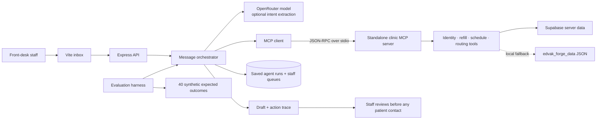

# Edvak Forge — AI Front Desk Prototype

A review-first front desk agent for Maplewood Family Clinic's synthetic take-home data. It classifies incoming requests, checks patient identity and clinic rules through MCP tools, prepares a staff-reviewed draft, and routes work to a human queue. It does not send messages, give clinical advice, approve prescriptions, or expose records to an unverified sender.

## Architecture



OpenRouter only extracts intent and preferences. Deterministic code enforces identity, emergency replies, refill eligibility, clinic hours, provider leave, holidays, and appointment conflicts. The model never receives a tool that can approve a prescription or send a message. The MCP server can also run over stdio as a standalone tool server.

## Run locally

Requirements: Node.js 20 or newer and npm.

```powershell
npm install
Copy-Item .env.example .env
npm run dev
```

Open `http://127.0.0.1:5173`. Without credentials, the app loads the provided JSON fixtures and uses the transparent local-rules mode. This mode is useful for reviewing the flow, not a substitute for a general medical language model.

To enable model-based intent extraction, set `OPENROUTER_API_KEY` and optionally `OPENROUTER_MODEL` in `.env`. The default model is `openai/gpt-4o-mini`. The API key stays on the Node server; it is not included in Vite's browser bundle. If the model request fails, processing falls back to local rules and records the mode in each result.

To read the already-seeded Supabase fixture instead of local JSON, set both `SUPABASE_URL` and `SUPABASE_SECRET_KEY` in `.env`. Use a server-side secret key only. Never use a Supabase secret/service-role key in a `VITE_*` variable or browser code. Local JSON remains the fallback when Supabase credentials are absent.

For a production build and local server:

```powershell
npm run build
npm start
```

Open `http://127.0.0.1:4317`.

## Supabase fixture

The project is seeded with synthetic data in `clinic_config`, `patients`, `medications`, `appointments`, `sample_messages`, and `evaluation_labels`. Processing a message with Supabase credentials also saves its draft/action record to `agent_runs`, its human routing reasons to `agent_queue_items`, and appointment changes to `appointments`. The Supabase connection made available to Codex is an administration connector; the running Node app needs its own server-only `SUPABASE_SECRET_KEY` (or legacy service role key) in `.env` to persist runtime actions. RLS is enabled and browser roles have no table access. To recreate the schema and seed it yourself:

```powershell
# Apply the SQL files in supabase/migrations with the Supabase CLI or SQL editor
npm run seed:supabase
```

The seed script reads the JSON fixtures and upserts `source_record` plus indexed fields. It requires `SUPABASE_URL` and `SUPABASE_SECRET_KEY` in `.env`.

## MCP tools

Run the clinic tool server over stdio with `npm run mcp`. It provides `set_current_message`, `find_patient`, `get_patient_medications`, `check_refill_eligibility`, `get_patient_appointments`, `find_appointment_slots`, `book_appointment`, `reschedule_appointment`, `cancel_appointment`, `route_message`, and `draft_reply`. Every patient-data or appointment mutation tool requires verified identity. Booking tools re-check conflicts at mutation time.

## Evaluation

```powershell
npm run evaluate
```

This processes all 40 messages against the take-home labels, prints a compact metric summary, and writes detailed per-message results to `reports/evaluation.json`. The report includes urgency accuracy, strict emergency recall, action exact match and micro F1, patient-candidate match, every missed emergency, and all detected `must_not` violations. The sample is intentionally tiny and synthetic; perfect performance on it does not establish clinical safety or generalization. Review false positives and negatives before changing policy rules.

Use **Run all & evaluate** in the inbox to see the same metrics in the UI. Each individual message can also be processed from its detail pane. Drafts and proposed actions always require staff review.

## Privacy and safety notes

- All included patient/message content is fictional synthetic data.
- The browser calls only this local/server API. Supabase's secret key and the OpenRouter key stay in Node environment variables.
- RLS is enabled on the fixture tables without anon/authenticated read policies. The server connects using a secret key.
- Patient name alone is only a possible match, never identity verification. No protected details are used or revealed without an exact contact, name-plus-DOB, or authorized caregiver match.
- Emergencies route immediately to a human. The draft only directs the sender to 911 or the nearest emergency department and says the clinic has been alerted.
- No prescription is approved or sent. All refill proposals are subject to provider approval.
- Appointment writes are in-memory for this prototype. They do not persist across API restarts or mutate the Supabase fixture.

## Useful commands

| Command | Purpose |
| --- | --- |
| `npm run dev` | Start the local API and Vite inbox |
| `npm run build` | Type-check the server and build the browser app |
| `npm start` | Serve the production build and API |
| `npm run evaluate` | Run the full benchmark and save `reports/evaluation.json` |
| `npm run mcp` | Start the standalone stdio MCP server |
| `npm run seed:supabase` | Upsert fixture data to the configured Supabase project |

